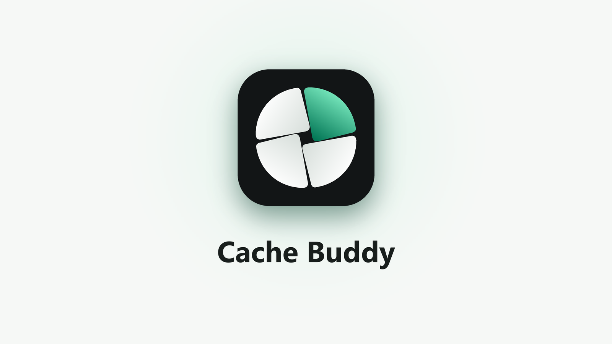
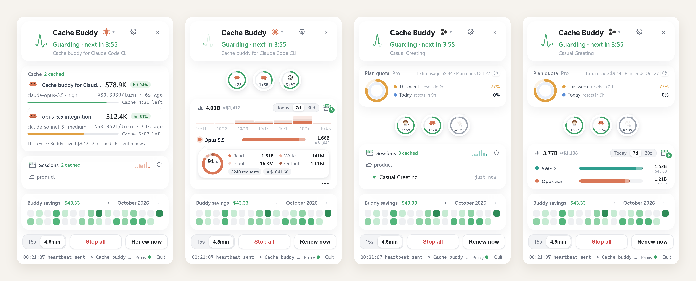

# Cache Buddy

Windows 托盘小面板,给 AI 编程助手打下手。

A tiny Windows edge-docked sidekick for AI coding agents.

## 功能 / Features

1. **缓存续期** — Devin / Droid / Claude Code 的 prompt cache 闲置约 5 分钟就过期,Cache Buddy 在过期前自动发一条心跳续上,回来接着聊还是缓存价。
2. **会话转换** — 把一个 agent 的会话原样搬进另一个 agent(Devin ↔ Droid),消息、工具调用、推理过程全保留,见 `session-bridge/`。
3. **Droid 账号迁移** — 把 Droid 会话在不同账号之间转移。
4. **用量面板** — 显示各模型 token 用量和套餐订阅/额度情况。

## 下载 / Download

编译好的 `CacheBuddy.exe` 在 [Releases](../../releases)(免安装,Windows 10/11 64-bit)。

使用说明:`使用说明.txt` · AI 助手安装/排障笔记:`README-for-AI.md` · 源码:`cache-buddy-src/` · 会话转换库:`session-bridge/`

## License

MIT
